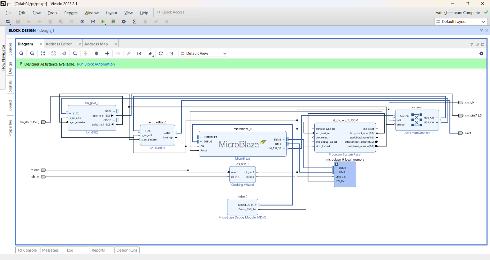
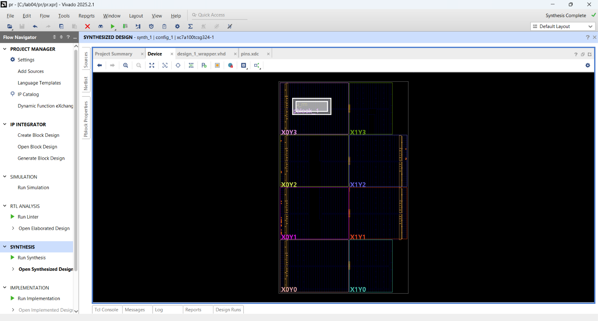

# Lab 04: Partial Reconfiguration with MicroBlaze

**Group A2**
**Advanced Hardware Engineering, WS-2026**
**Prof. Dr.-Ing. Ali Hayek**

---

## 1. Design Overview

The static region contains the MicroBlaze processor, its local memory, the MicroBlaze Debug Module, the Clocking Wizard, the Processor System Reset, an AXI UART Lite for serial communication with the PC, and an AXI GPIO configured as two 16-bit dual channels. One channel (`rm_din`) drives data into the reconfigurable partition, and the other (`rm_dout`) reads the result back. The reconfigurable partition sits around a single instance named `u_rm`, which can hold one of three modules at a time:

- **RM A**: pass-through (`dout <= din`)
- **RM B**: bitwise invert (`dout <= not din`)
- **RM C**: swap bytes (`dout <= din(7 downto 0) & din(15 downto 8)`)

All three modules share identical ports (`clk`, `din(15:0)`, `dout(15:0)`), as required by the DFX flow, and are synchronous to the same clock supplied by the static region (`rm_clk`).

### Block Design



### Floorplan (Pblock)



The Pblock (`pblock_1`) was drawn in clock region X0Y3 and spans:
```
SLICE_X4Y170:SLICE_X35Y184
DSP48_X0Y68:DSP48_X0Y73
RAMB18_X0Y68:RAMB18_X0Y73
RAMB36_X0Y34:RAMB36_X0Y36
```
`RESET_AFTER_RECONFIG` was set to `true` and `SNAPPING_MODE` to `ON`. This Pblock comfortably exceeds the resource needs of any of the three modules, each of which uses only a handful of flip-flops and LUTs.

---

## 2. Bitstreams

| Configuration | File | Size (bytes) |
|---|---|---|
| Full (static region + RM A) | `impl_1/top.bit` | 3,825,906 |
| Partial, RM A | `impl_1/u_rm_rm_a_partial.bit` | 703,543 |
| Partial, RM B | `child_0_impl_1/u_rm_rm_b_partial.bit` | 703,543 |
| Partial, RM C | `child_1_impl_1/u_rm_rm_c_partial.bit` | 703,543 |

The full bitstream is roughly 5.4 times larger than any partial bitstream, because it configures the entire chip (static region and partition together), while a partial bitstream configures only the reserved rectangle.

---

## 3. Software

`main.c` repeatedly writes a 16-bit counter value to the GPIO output channel (`rm_din`) and reads the result back from the input channel (`rm_dout`). It also writes a fixed test value (`0x0001`) first to identify which module is currently loaded, since the software has no other way to know:

| Module | Response to input 0x0001 |
|---|---|
| RM A | 0x0001 |
| RM B | 0xFFFE |
| RM C | 0x0100 |

GPIO base address: `0x40000000` (confirmed in the Vivado Address Editor and in `xparameters.h` as `XPAR_AXI_GPIO_0_BASEADDR`).

---

## 4. Terminal Output Before and After Each Swap

### Programming the full bitstream (RM A active)

```
loaded: RM A (pass-through)   in=036F out=036F
loaded: RM A (pass-through)   in=0370 out=0370
loaded: RM A (pass-through)   in=0371 out=0371
...
loaded: RM A (pass-through)   in=037B out=037B
```

### Swap to RM B (partial bitstream)

```
loaded: RM A (pass-through)   in=075C out=075C      <- last line before swap
loaded: RM B (invert)         in=096D out=F692      <- first lines after swap
loaded: RM B (invert)         in=096E out=F691
loaded: RM B (invert)         in=096F out=F690
loaded: RM B (invert)         in=0970 out=F68F
...
```
The counter climbed from `075C` to `096D` with no reset or discontinuity. Once RM B was loaded, `out` became the bitwise inverse of `in` (e.g. `in=096D`, `out=F692`; `0x096D XOR 0xF692 = 0xFFFF`).

### Swap to RM C (partial bitstream)

```
loaded: RM C (swap bytes)   in=0282 out=8202
loaded: RM C (swap bytes)   in=0283 out=8302
...
loaded: RM C (swap bytes)   in=0290 out=9002
loaded: RM C (swap bytes)   in=0291 out=9102
```
`out` is the byte-swapped version of `in` (e.g. `in=0282` -> high byte `02`, low byte `82` -> `out=8202`).

### Swap back to RM A (partial bitstream)

```
loaded: RM C (swap bytes)   in=03F6 out=F603
loaded: unknown             in=03F7 out=FFFF        <- captured mid-reconfiguration
loaded: RM A (pass-through) in=03F8 out=03F8
loaded: RM A (pass-through) in=03F9 out=03F9
loaded: RM A (pass-through) in=040A out=040A
...
loaded: RM A (pass-through) in=041D out=041D
```
One line reads `out=FFFF`, identified as `unknown`, caught exactly during the reconfiguration window.
The complete serial terminal session is included in `logs/serial_terminal_full_log.txt`.

---

## 5. Answers to the Task 4 Questions

**How large is the full bitstream and how large are the partial ones?**
The full bitstream is 3,825,906 bytes. Each partial bitstream is 703,543 bytes, about 5.4 times smaller.

**Why do the three partial bitstreams have the same size?**
A partial bitstream configures a fixed set of configuration frames, determined entirely by the size and location of the Pblock, not by the logic inside it. Since all three modules (RM A, RM B, RM C) share the same Pblock, every partial bitstream covers exactly the same number of frames regardless of which few LUT equations differ between the modules. The actual logic differences (pass-through, invert, swap bytes) are tiny compared to the frame structure, so they do not change the file size.

**What happened to the terminal output during the swap?**
One line showed `loaded: unknown   in=03F7 out=FFFF`, captured during the RM C to RM A swap. This matches the design rule that a partition's outputs are undefined while it is being reconfigured, since the module has not yet been loaded and its previous outputs are no longer being driven. The GPIO read back `0xFFFF`, which the software correctly classified as "unknown" because it does not match any of the three expected test responses.

**Why was the MicroBlaze not affected?**
The MicroBlaze, its local memory, the MDM, the clocking and reset logic, and the AXI UART Lite are all part of the static region, which lies entirely outside the Pblock. Partial reconfiguration only reprograms the configuration frames inside the Pblock's boundary; it never touches frames belonging to the static region. This was confirmed directly: the software's counter value never reset or skipped across any of the three swaps, it simply kept incrementing (`075C` -> `096D`, `0291` -> `03F6`, `03F8` -> `041D`), proving the processor kept running uninterrupted throughout.

**When would you not use reconfiguration?**
Partial reconfiguration adds overhead that is not worth it for small, simple, or rarely-changing designs. The Pblock floorplanning, the DFX project conversion, and the separate implementation runs for every configuration (one parent run plus one child run per extra module) significantly increase design time and tool runtime. It also permanently reserves chip area for the largest possible module, even while a smaller module is loaded, which wastes resources if the application does not actually need to swap hardware functions at runtime. If a design's function never needs to change after it is deployed, a normal static bitstream is simpler, faster to implement, and avoids the decoupling and timing closure issues introduced by reconfigurable partitions.

---

## 6. Summary

- **Static region**: the part of the design that is implemented once and never changes. Here it contains the MicroBlaze processor, its memory, the debug module, the UART, and the AXI GPIO. It keeps running throughout any partial reconfiguration.
- **Reconfigurable partition**: a fixed rectangle (Pblock) reserved on the chip with a fixed port interface. Its contents can be swapped at runtime without affecting the rest of the design.
- **Reconfigurable modules**: the interchangeable implementations that can occupy the partition, here RM A (pass-through), RM B (invert), and RM C (swap bytes). All share identical ports so any one of them fits the same partition.
- **Partial bitstreams**: small bitstream files that configure only the partition's frames. They are much smaller than a full bitstream and can be loaded over JTAG (or self-reconfiguration hardware) while the static region continues running, enabling the hardware function of a system to change without any downtime or loss of processor state.

This lab demonstrated that a MicroBlaze-based system can have part of its hardware swapped live, with the processor, memory, and communication path completely undisturbed, and that the practical cost of this capability is chip area reserved for the partition and additional implementation time for each extra configuration.
